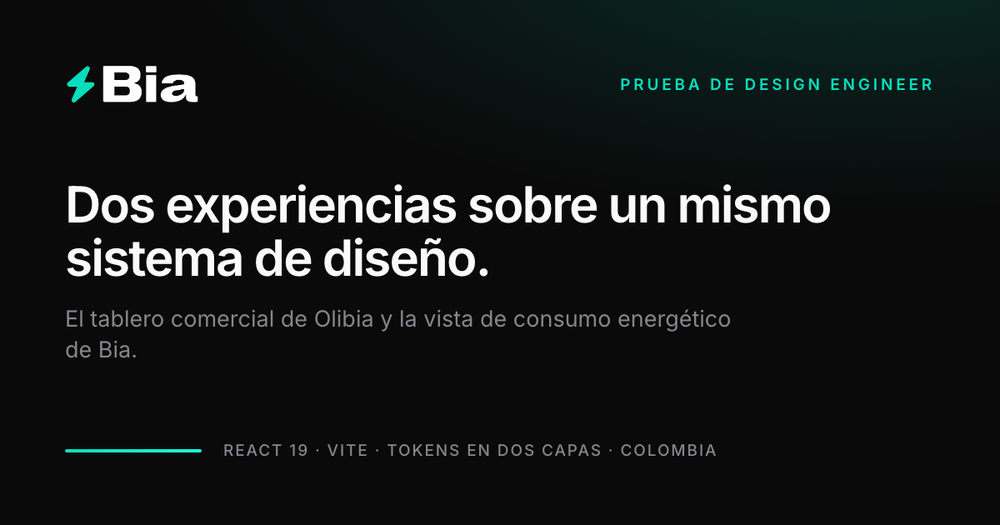

# Bia · Olibia — Prueba Design Engineer

Dos experiencias sobre un mismo sistema de diseño: el tablero comercial de **Olibia** y la vista de consumo energético de **Bia**.

El enunciado pedía dos tareas y una vista cada una. Lo que hay acá es el recorrido completo que esas vistas necesitaban: **auditar el dato** antes de dibujar, **decidir qué preguntas** contesta el producto, **diseñar el sistema** que las sostiene y **escribirlo** con las garantías que lo hacen defendible. Cada decisión está argumentada en el código, no sólo implementada — si una razón dejó de ser cierta, el comentario dice por qué cambió.

|                   | Olibia — tablero comercial                                                | Bia — consumo energético                                     |
| ----------------- | ------------------------------------------------------------------------ | ------------------------------------------------------------ |
| **Producto**      | Diagnosticaba y no podía tratar: hoy se avanza de etapa y se registra el contacto. | Una factura inflada, cinco minutos y ninguna experticia: contesta, no informa. |
| **UX**            | Cada control vive dentro de lo que afecta; el alcance se declara por contención. | Sin filtros ni menús: una pregunta por bloque, y después explorar. |
| **Diseño**        | Tokens en dos capas, dos temas, acento cian.                             | Los mismos tokens, acento teal, y una sola pieza expresiva.   |
| **Ingeniería**    | Todo se deriva de un punto: cambiar una etapa recalcula el resto.          | Los totales se derivan de los tramos del día: no hay cifra escrita a mano. |
| **Accesibilidad** | Piso táctil de 44px, foco encerrado en los diálogos, estado anunciado.     | Igual, y el punteado significa siempre "sin confirmar".        |

**Demo:** [Olibia](https://bia-olibia-design-engineer.vercel.app/olibia) · [Bia](https://bia-olibia-design-engineer.vercel.app/bia)



---

## Ejecutar

Requiere Node.js **20.19+ o 22.12+** — el rango que exige Vite 8, declarado en `engines`. Node 21 no sirve.

```sh
npm ci
npm run dev
```

Abre la URL que imprime Vite (por defecto `http://localhost:5173`).

| Comando                  | Qué hace                                                                |
| ------------------------ | ----------------------------------------------------------------------- |
| `npm run dev`            | Servidor de desarrollo                                                  |
| `npm run build`          | Compilación de producción                                               |
| `npm run preview`        | Sirve el build                                                          |
| `npm run check:contrast` | **Verifica el contraste WCAG de los tokens, en ambos temas**            |
| `npm run make:images`    | Genera la carta social y los iconos, con Chrome headless                |

Ese último no es decorativo: lee `src/tokens.css`, resuelve las variables y corre **172 comprobaciones** — 43 pares texto/surface en las cuatro combinaciones que la aplicación puede pintar: dos marcas por dos temas. Sale con código 1 si alguno baja del mínimo. Encontró cuatro errores reales antes de que llegaran a un commit, y otros dos cuando se conectó el acento por marca: el cian brillante del tema oscuro se colaba en el tema claro, donde no llegaba a AA.

Y tiene un techo que conviene decir: **compara token contra token, así que no ve nada translúcido.** Un lavado de color sobre una superficie compone un tercer color que no está en `tokens.css` y que ningún par cubre. Ese agujero dejó pasar un relleno proporcional que hundía la segunda línea de las fichas a 3.36:1; apareció midiendo el color compuesto en el navegador, no acá.

---

## Sistema de diseño

Lo comparten las dos experiencias; se diferencian sólo por un acento cromático.

La paleta sale de la **identidad pública de Bia**, no de una invención: teal `#08DDBC`, gradiente a `#17FFDB`, neutrales zinc, tipografía Inter, y el vidrio tenue que usa su sitio.

El modo oscuro es el canónico porque **sus colores sólo existen sobre oscuro**: 15.21:1 contra 1.27:1 sobre blanco. El claro se deriva oscureciendo el acento hasta alcanzar AA.

Los tokens van en **dos capas**: primitivas de marca y roles semánticos. Ningún componente nombra un color crudo, y por eso ni el cambio de tema ni la variación de identidad entre Olibia y Bia tocan un solo componente.

**La marca aporta valores y el tema elige cuál usa.** Cada ruta declara la suya en `<html>` —Olibia es cian, Bia es teal— y el acento, su gradiente, su foco y su halo salen de ahí. La versión brillante es para el tema oscuro y la "ink" para el claro, así que es imposible que una termine en un fondo donde no llega a AA. Antes el mecanismo existía pero nadie lo aplicaba, y aplicarlo a pelo era peor: el bloque de marca pisaba al tema y dejaba el cian brillante sobre papel.

---

## Decisiones · Olibia

El starter mostraba indicadores. La decisión de fondo fue cambiar la pregunta: **el sitio no muestra números, contesta las cinco que se hace quien es dueño de la meta**.

Antes de dibujar audité el dato, y ahí apareció lo que ninguna cifra decorativa iba a decir: **la meta de 10 no se alcanzó ni una vez en siete meses** (máximo: 8), el canal de una empresa **cambiaba entre periodos** porque venía del índice de la fila en un array, y los referidos valen el doble que el outbound ($64,7 M contra $31,3 M).

El total del pipeline ya se calculaba para sacar porcentajes y **nunca se mostraba**: hoy encabeza la lectura como banda, un escalón por debajo de la meta, porque dos números del mismo peso se leerían como una contradicción.

El resumen de IA pasó de panel a conversación, y **no entró como séptimo destino del dock** —se decidió midiendo: con los filtros, los siete destinos caen a 41,9px, bajo el piso táctil de 44px—. El panel abierto es opaco: sobre el vidrio del dock, sus etiquetas caían a 2,84:1.

El tablero diagnosticaba y no podía tratar: la única acción era «ya lo miré». Adelantar de etapa y registrar el contacto —qué se habló y para cuándo quedó el próximo— lo vuelven un producto que se usa.

La alerta de vencido necesitó declarar un «hoy»: un tablero ficticio no tiene fecha, y una alerta que suena en el 100% de las filas no es una alerta.

## Decisiones · Bia

La segunda tarea pedía una vista para alguien que administra tres cafeterías: un objetivo clarísimo —entender qué está pasando con el consumo— que solo se logra comparando. La decisión de fondo fue que la comparación sea la protagonista y que **los meses sean el marco**: la página abre con dos columnas, la de referencia y la que se mira, con la cifra debajo de cada una. Un "+25%" suelto no quiere decir nada; con los meses al lado, sí.

La segunda: una tira de diez meses que es a la vez el control y la respuesta. Los meses se eligen arriba, en desplegables, o se tocan dos en la tira; el gráfico compara ese par con cualquiera y el salto de octubre se ve sin leer una línea.

Una sola regla de color: el teal es el mes que mirás, el gris el de referencia, el rojo solo cuando el cambio es malo y el punteado solo "sin confirmar".

Los hechos van con tinta sólida y las hipótesis con contorno punteado, y el límite se dice de frente: 780 de los 1.200 kWh fueron de día, así que ninguna hipótesis cubre la parte más grande del problema. Por eso el paso que se ofrece es una medición y no un arreglo. El asistente responde con reglas sobre el fixture, sin modelo de AI, y calcula lo mismo que la gráfica.

## Qué deberíamos probar

El PDF pide esto explícitamente, y sale de los fallos que fueron apareciendo:

**Recorridos con estado heredado.** Filtrar por algo que no existe en el otro periodo y cambiar de periodo. Septiembre no tiene Negociación. Hay dos casos distintos que conviene no confundir: la dimensión existe y no hay datos (etapa) frente a la dimensión no existe (movimiento, porque septiembre no tiene mes previo). El segundo retira el filtro solo y lo anuncia.

**Teclado completo en el detalle.** Abrir, tabular hasta el final y seguir: el foco debe circular dentro. Escape cierra y **el foco vuelve al botón que lo abrió**. Sin el encierro, el tabulador se va a la página de atrás, que está oculta para el lector de pantalla pero sigue siendo tabulable.

**Un teléfono real, no el navegador achicado.** Safari en iOS hace zoom al enfocar un campo de menos de 16px. En ancho de móvil los siete campos están en 16px exactos —el del asistente incluido—; desde 1024px bajan a 12-14px, y ahí convendría verificar en un iPad en horizontal. Eso no se reproduce redimensionando una ventana de escritorio.

**Una ventana baja, no sólo una angosta.** Con el teléfono acostado (844×390) el dock flotante se le monta a la marca: 24px de solape vertical. Es anterior a este rediseño y está sin resolver.

**El alto de la cabecera contra los enlaces profundos.** `scroll-margin-top` se calcula con `--header-height`, que es un valor fijo. Si la cabecera crece y el token no, `/olibia#q-meta` aterriza con el título tapado. Cada cambio de tipografía ahí hay que medirlo: hoy son 69.00px con desfase 0.00 en siete anchos.

**Ambos temas en cada cambio, midiendo el color compuesto.** El gate de contraste compara tokens y no ve transparencias. Lo que se pinta encima de una superficie hay que medirlo en el navegador. El panel del asistente nació con el vidrio del dock y el gate lo dejó pasar: medido, la etiqueta y la nota al pie daban **2,84:1** sobre un glifo oscuro. Por eso hoy es opaco.

**El asistente en un teléfono de verdad.** Su despeje sobre el dock sale de `--dock-height`, derivado de los tokens que dibujan el dock, y está verificado por geometría —58px de dock, burbuja a 82px, 12px libres— pero **no mirado en un teléfono real**: el redimensionado del navegador dejó de aplicar a mitad de la verificación. Y el botón de cerrar mide 36px, copiando al del detalle, que ya estaba por debajo del piso de 44.

**El dock de móvil sobre contenido movido.** Con el desenfoque vuelto a andar, la barra deja de transparentar el texto, pero sigue siendo vidrio: sobre un panel claro o sobre una imagen, los iconos quedan sobre una mancha de luminancia desconocida. Es lo único que hay que mirar en un teléfono real.
**La vista de Bia en un teléfono real.** La cascada tiene dos columnas y el tramo de acento quedó medido en 44px justos: en un ancho menor hay que comprobar que no se apelmice. Y los botones de orden de la tabla de Olibia miden 41px — por debajo del piso de 44 que el resto de la familia respeta, porque el encabezado de la tabla anula el mínimo a propósito. Conviene decidir si se acepta o se sube.

**El movimiento reducido, de verdad.** La cifra de la factura cuenta hacia arriba en 700ms; con `prefers-reduced-motion` tiene que aparecer ya final. Se comprobó contando los valores intermedios en el navegador: con movimiento hay ocho cifras distintas, sin movimiento una sola.

---

## Herramientas y AI

- **Vite + React 19 + React Router.** El starter traía un build de esbuild sin dev server: cada ajuste visual exigía rebuild y refresco manual. Para una prueba que evalúa microinteracciones, esa fricción se nota en el acabado.
- **Radix Tooltip + Motion.** Radix aporta comportamiento —posicionamiento con detección de colisión, apertura por foco de teclado, Escape, roles ARIA— y ni un pixel de apariencia.
- **Prettier.** El starter venía en líneas de hasta 2.000 caracteres: el dashboard entero ocupaba 13 líneas.
- **Claude Code** como par de trabajo, dirigido: yo tomé las decisiones de producto y diseño, y las empujé hasta que resistieran. Varias propuestas suyas las rechacé y se rehicieron. Dos ejemplos: esconder siete de las ocho filas del bloque de trabadas para ahorrar alto en móvil —que destruye la comparación que hace legible el bloque— y dar por bueno un truco de observador sobre la propia cabecera que resultó encenderse desde el primer cuadro.
- **Chrome DevTools vía CDP**, manejando un Chrome propio para medir y capturar en ambos temas y a distintos anchos. Ahí aparecieron los bugs que el código no delata, y los números que están en este README.
- **Scripts de medición propios**, para contraste, geometría y composición de color. Dos quedaron versionados: `check:contrast` y `make:images`, que renderiza la carta social y los iconos con Chrome headless desde los mismos tokens que la aplicación — la miniatura de un enlace compartido es diseño, no un archivo que alguien subiu una vez.
- **El vidrio del sitio estaba muerto y nadie lo notó.** Vite 8 minifica el CSS con lightningcss, y cuando encuentra las dos formas de `backdrop-filter` —la estándar y la de WebKit— conserva **la última**. El código las escribía en ese orden, así que en producción quedaba sólo `-webkit-backdrop-filter`, que Chrome 156 ya no aplica: el dock, la lengüeta y la burbuja del asistente flotaban sin desenfoque y el texto se leía a través de los iconos. El `backdrop-filter` estándar solo, con `build.cssTarget` en navegadores modernos, y el vidrio volvió. Lo encontró una medida, no una lectura: **un gate que compara tokens nunca lo ve**.

### Qué refiné personalmente

Las decisiones de producto y de diseño, y la revisión visual completa. El marco de las cinco preguntas, el criterio de que el acento señale en vez de decorar, el ámbar reservado, qué bloque responde a los filtros y cuál no, el peso de la marca en la cabecera y el rediseño del detalle salieron de mirar la pantalla y decir "esto no está bien", no de aceptar la primera versión.

En Bia, lo mismo: separar el hecho de la hipótesis con un punteado que no aparece en ningún otro lado, derivar el paso del dato y no del guion, y recortar la cascada dos veces porque las dos primeras se leían como dos cajas grises.

### Tiempo dedicado

**21,6 horas**, en cinco días.

El método, porque un número sin método no es un dato: el historial de commits es la única evidencia de cuándo hubo trabajo. Un hueco largo entre dos commits **no** es trabajo — los de 15,8 h, 18,8 h, 22,6 h y 8,6 h son noches y un día entero, y los de 2,5 h y 2,6 h una tarde. Los de 40 a 56 minutos sí lo son: es el patrón de commit, medir en el navegador y volver a commitear.

Con ese corte de dos horas, el trabajo cae en **8 sesiones**. Lo medido dentro de las sesiones son 16,5 horas; sumándole el trabajo previo a cada primer commit —que no se ve en el historial, y se estima con la mediana de los huecos internos: 38 minutos— dan 21,6 horas. El rango honesto es **17 a 22 horas**.

| Día | Trabajo |
| --- | --- |
| Jueves 29/10 | 8,3 h |
| Viernes 30/10 | 4,0 h |
| Sábado 31/10 | 4,9 h |
| Domingo 1/11 | 2,5 h |
| Lunes 2/11 | 1,8 h |

De calendario fueron 95 horas entre el primer y el último commit. Las otras 73 fueron sueño y familia.

---

## Estructura

```
src/
  tokens.css              sistema de diseño en dos capas
  styles.css              estilos, escritos mobile-first
  shared/
    theme.jsx             tema claro/oscuro con preferencia del sistema
    useDocumentTitle.js   el título de la pestaña, según la ruta
    useBrand.js           la marca en <html>, que decide el acento
    useScrolled.js        el centinela del desplazamiento, para el velo
  routes/bia/
    BiaDashboard.jsx      arma la página y reparte el alcance de cada bloque
    Veredicto.jsx        ¿Qué pasó? La cifra y la frase que la corrige
    Explorador.jsx       Comparar: la tira de meses y la gráfica en vivo
    Evidencia.jsx        ¿Por qué? Hechos e hipótesis, en registros distintos
    Paso.jsx             ¿Qué hago? El paso y su alternativa condicional
    Dialogo.jsx          el pedido del diagnóstico, con el foco encerrado
    Asistente.jsx        la burbuja que responde con reglas sobre el dato
    Estados.jsx          carga y error
    useBiaData.js        la carga simulada
    data.js              diez meses por sede; los totales se derivan
    format.js            pesos, kWh y porcentajes al estilo colombiano
    bia.css              los estilos de esta experiencia, aparte
  routes/olibia/
    OlibiaDashboard.jsx   arma la página y reparte el alcance de cada bloque
    Goal.jsx              ¿Vamos a llegar?
    Stalled.jsx           ¿Qué se está cayendo?
    Workload.jsx          ¿Dónde me meto?
    Origin.jsx            ¿De dónde viene el valor?
    Trend.jsx             ¿Cómo venimos?
    Dock.jsx              índice navegable de las cinco preguntas
    OpportunityDetail.jsx
    Movement.jsx
    data.js               datos con identidad estable por oportunidad
    movement.js           comparación entre periodos
    filters.js
    useFilterParams.js    los filtros viven en la URL
scripts/
  check-contrast.mjs      72 comprobaciones WCAG, falla el proceso si algo baja
  make-images.mjs         renderiza la carta social y los iconos
  og-card.html            la carta, en HTML, saliendo de los tokens
public/
  og-image.png            1200x630 — previsualización al compartir el enlace
  social-preview.png      1280x640 — carta del repositorio
  apple-touch-icon.png    180x180 — icono de iOS
  icon-512.png            512x512 — icono del navegador
```

### Accesibilidad

El starter traía una base razonable (ARIA, HTML semántico, `focus-visible`, `prefers-reduced-motion`) y **la condición fue no perder nada de eso**: sólo sumar.

- 72 comprobaciones de contraste verificadas en ambos temas, automatizadas.
- Foco encerrado en el diálogo, con retorno al disparador.
- Un solo `h1` por página y ningún salto de nivel: `h1 Olibia` → siete `h2` en pantalla (la banda del pipeline, las cinco preguntas y la lista), y hasta nueve con el asistente o el detalle abiertos; `h1 Bia` → cinco `h2`, uno por pregunta.
- `prefers-reduced-motion` por fin reduce algo — en el starter el media query existía pero no había una sola transición.
- Nada se codifica sólo por color: el realce suma peso tipográfico, el movimiento suma un punto, las etapas llevan su nombre escrito.
- Áreas táctiles de 44px como mínimo, **incluidos los desplegables y el buscador** — el piso estaba declarado sólo en `button` y seis controles quedaban por debajo.
- Tipografía en `rem`: quien agranda la letra del navegador recibe texto proporcionalmente mayor.

---

Datos ficticios. Sin conexión a sistemas reales de Bia u Olibia.
